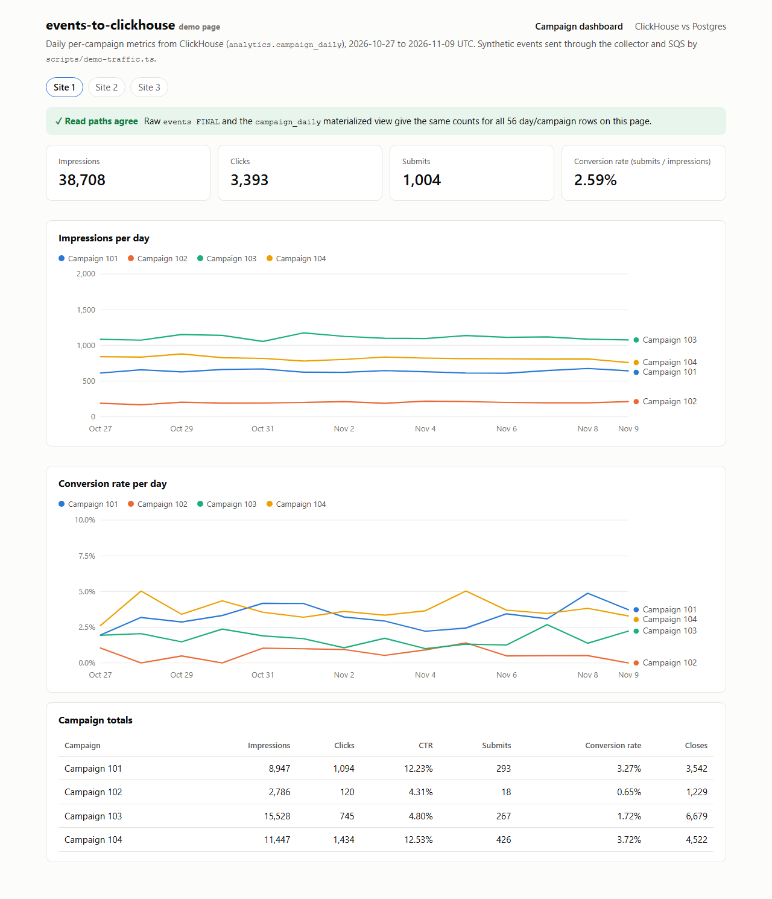
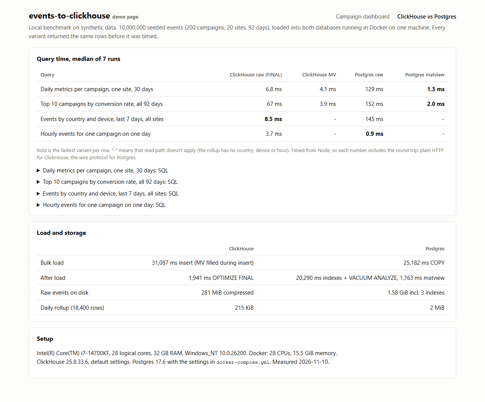

# events-to-clickhouse

[](https://github.com/fatih255/events-to-clickhouse/actions/workflows/ci.yml)

Popup analytics events go from an HTTP collector through SQS into ClickHouse, with a materialized view for daily campaign metrics and the same dataset in Postgres for comparison.



## Why this exists

At Popupsmart our team moved analytics from OpenSearch to ClickHouse, because of query performance and the work of running it. I was involved in the schema, event ingestion, migration checks and the application's queries. More on [my experience page](https://fatihinci.com/experience/#analytics). This repo is a small from-scratch version of that pattern, not the production code. If I did it again I'd leave more time for running both read paths side by side, since finding out why two numbers differ can take longer than rewriting the query. So that check is built in here.

## What it shows

- **Collector** (`src/collector`): `POST /events` validates each event with zod and sends the valid ones to SQS in batches of 10. Invalid ones come back by index.
- **SQS** via ElasticMQ, with a dead-letter queue after 5 receives. It's the AWS SDK, so real SQS is an endpoint change.
- **Batch writer** (`src/writer`): parallel long polls, flush at 1,000 messages or 1 second, retries with backoff, and messages are deleted only after the insert succeeds.
- **Idempotency**: `event_id` comes from the client. The writer skips ids repeated in the batch or already stored (bloom filter index on `event_id`). The lookup runs inside the retry, so an insert that landed but timed out isn't written twice. `ReplacingMergeTree` catches anything that slips through.
- **Schema** (`src/clickhouse/schema.ts`): monthly partitions, `ORDER BY (site_id, campaign_id, toDate(ts), event_id)`, and a materialized view into a `SummingMergeTree` with daily impressions, clicks, submits and closes per campaign.
- **Both read paths**: `npm run check:read-paths` computes the daily aggregate from raw events (`FINAL`) and from the view, and lists every day, campaign and field where they differ. The dashboard runs the same check for what it shows.
- **Postgres comparison**: the same seeded 10M rows in both databases, the same queries, answers checked for equality before timing.

## Run it

Needs Docker and Node 24.

```sh
cp .env.example .env
docker compose up --build
```

That starts ClickHouse, ElasticMQ, Postgres, the collector (`:18120`), the writer and the dashboard at [localhost:18121](http://localhost:18121). A one-shot `demo-traffic` service sends 150,000 synthetic events through the collector and repeats 5% of the requests on purpose. ClickHouse should still end up with exactly 150,000 rows.

```sh
npm ci
npm run check:read-paths   # raw vs materialized view, exits 1 on a mismatch
npm run traffic            # send the same traffic again; numbers shouldn't move
npm run bench              # 10M rows into ClickHouse and Postgres, writes bench/results.json
npm run screenshots        # Playwright screenshots of both pages
```

To send your own event (the timestamp has to be within the last 30 days):

```sh
curl -X POST localhost:18120/events -H 'content-type: application/json' -d '{
  "event_id": "6f1c2a8e-3b4d-4c5e-9f60-718293a4b5c6", "type": "click",
  "site_id": 1, "campaign_id": 101, "timestamp": "2026-11-10T09:30:00Z",
  "device": "mobile", "country": "TR"}'
```

## Benchmark

This is a local benchmark on synthetic data: 10M seeded events (200 campaigns, 92 days), both databases in Docker on one machine (i7-14700KF, 32 GB RAM, Windows 11, Docker with 28 CPUs and 15.5 GiB). ClickHouse 25.8 ran on defaults, Postgres 17.6 with the settings in `docker-compose.yml`. Each number is the median of 7 runs after a warm-up, timed from Node, round trip included. Full output is in [`bench/results.md`](bench/results.md).

| Query | ClickHouse raw (FINAL) | ClickHouse MV | Postgres raw | Postgres matview |
|---|--:|--:|--:|--:|
| Daily metrics per campaign, one site, 30 days | 6.8 ms | 4.1 ms | 129 ms | 1.3 ms |
| Top 10 campaigns by conversion rate, all 92 days | 67 ms | 3.9 ms | 152 ms | 2.0 ms |
| Events by country and device, last 7 days | 8.5 ms | - | 145 ms | - |
| Hourly events for one campaign on one day | 3.7 ms | - | 0.9 ms | - |

Raw events took 281 MiB in ClickHouse and 1.58 GiB in Postgres, indexes included.

How I read it: on filtered scans of raw events ClickHouse was 17 to 19 times faster. The full-table query was only about 2 times faster, and `FINAL` is a big part of that (67 ms vs 3.9 ms from the view). Postgres won the indexed point lookup and the rollup reads, where ClickHouse's fixed cost of a few milliseconds per query is most of the time. The Postgres materialized view is a full rebuild you trigger yourself (1.8 s here). The ClickHouse one updates on every insert.

The bench times ClickHouse with plain `fetch`. On this machine `@clickhouse/client` added a steady ~14 ms per call, which would have measured the client instead of the database.



## Tests

```sh
npm test                                            # unit
docker compose up -d clickhouse elasticmq postgres
npm run test:integration                            # against the real services
```

Unit tests cover validation, size and time based batching, backoff, delete-after-insert, redelivery and lost-response cases, the collector's responses and the read-path diff.

Integration tests send events through the collector, SQS and the writer into ClickHouse, then check raw and materialized view counts. They resend events and force an SQS redelivery after a lost delete, and the counts don't change. They also insert duplicates behind the writer's back and check that the diff points at the exact field. A small benchmark run checks every engine and read path returns identical rows. CI runs these with Docker Compose, then starts the whole stack and checks the demo traffic lands with no duplicates.

## Limits

- One writer. Two writers could both pass the "already stored?" check for the same redelivered message. Raw counts with `FINAL` would stay right, the view would count it twice, and the read-path check is what would catch it.
- Days are UTC. Per-site time zones would need the zone in the rollup key.
- No auth, rate limiting or bot filtering on the collector.

## License

MIT
